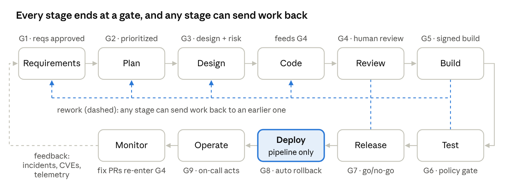
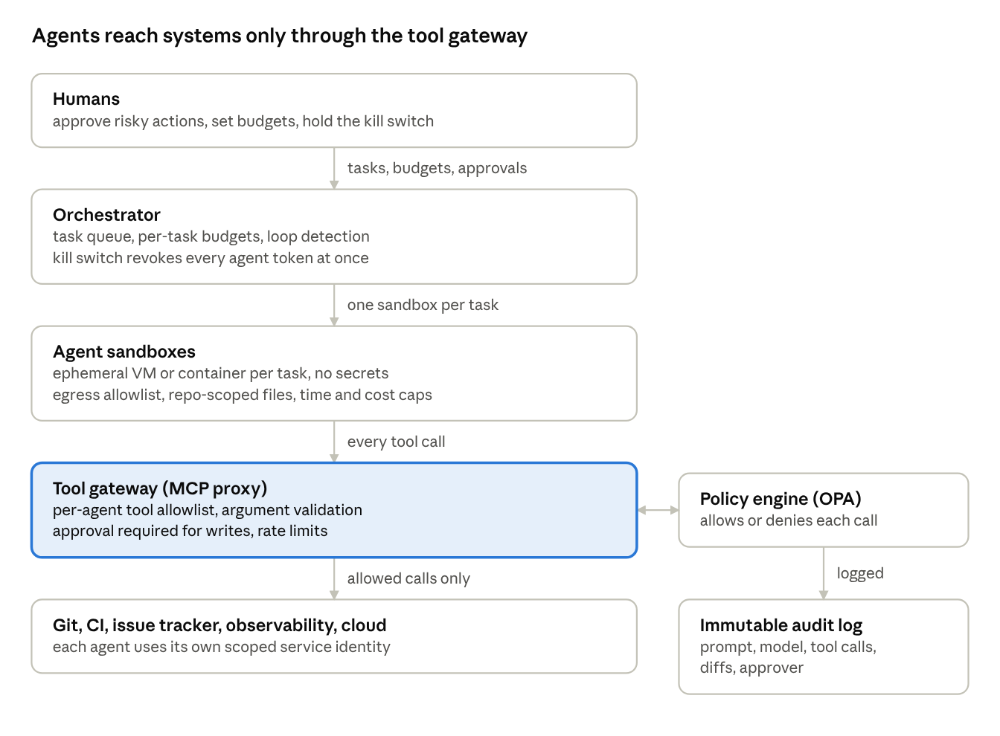

# DevSecOps SDLC with AI Agents

Oct 11, 2026 · @Nguyen Trung Kien

## Purpose and scope

AI agents produce artifacts at every SDLC stage; deterministic controls and named humans own every gate. This reference defines the stages, their outputs, the agents, the controls around them and the rollout path.

- **Audience:** engineering leads, AppSec, platform and SRE teams adopting agents in delivery.

- **In scope:** plan through monitor, the agents' own security, metrics and rollout.

- **Out of scope:** vendor and model selection, and team-specific tooling choices (named tools are examples).

## Design principles

Six rules apply at every stage; a proposal that breaks one needs a security sign-off.

1.  **Agents propose, deterministic controls decide.** Every gate is a pipeline check, a policy-as-code rule or a named human, never an agent's opinion.

2.  **Separation of duties.** The agent that writes a change never reviews, approves or deploys it. Each role has its own identity and permissions.

3.  **Agents are untrusted contributors.** Same controls as a new contractor with commit access: sandbox, least privilege, review, audit.

4.  **Everything as code.** Specs, threat models, policies, infrastructure, pipelines and agent config (prompts, skills, tool allowlists) are versioned and reviewed.

5.  **Small batches, fast rollback.** Lean flow keeps the blast radius of any one agent mistake small.

6.  **Humans own risk.** Agents may recommend risk acceptance; only a named person signs it.

## Autonomy levels

Every agent use case gets a level, and moves up only on measured evidence. Irreversible or outward-facing actions (production deploys, data deletion, sending messages, payments, publishing) stay at L1 or below.

| Level | Mode | Example |
|----|----|----|
| L0 | Suggest only | Chat assistant |
| L1 | Draft; a human applies | Agent opens a PR, a human merges |
| L2 | Acts in a sandbox; a human approves the result | Agent runs tests or migrations in an ephemeral environment |
| L3 | Acts within guardrails; a human audits after | Patch-level dependency bumps auto-merge when every gate passes |
| L4 | Fully autonomous in production | Not recommended, except tightly bounded reversible tasks |

## Lifecycle and gates

Eleven stages run in order with nine gates (G1 to G9). That order is the normal path, not a one-way street: any stage can send work back to any earlier stage (see *Going back* below), and production feedback flows into requirements and planning. Agents work inside each stage, and no agent deploys.

SDLC loop · 10 stages, 8 gates

The diagram shows the forward path: left to right, then back along the lower row. Rework can jump back from any stage to any earlier one.

| Stage | Agent work | Deterministic controls | Gate |
|----|----|----|----|
| Requirements | Draft the feature brief, stories with acceptance criteria, non-functional and compliance requirements, security and abuse cases; flag gaps and conflicts | Template completeness; every requirement has an ID; data classification tag per epic | G1: PM and tech lead approve the requirements |
| Plan | Turn requirements, CVE feeds and incidents into sized, ordered tickets; propose dependencies and risk class | Every ticket links a requirement ID and carries a risk class | G2: PM or lead prioritizes |
| Design | Draft the design doc, ADRs, API contracts and data model; STRIDE / LINDDUN threat model and data-flow diagram; mitigations linked to stories | Template completeness; high-risk features require AppSec | G3: tech lead approves the design; risk owner accepts or mitigates |
| Code | Implement in an ephemeral sandbox, small PRs, tests from the spec first | Pre-commit hooks: secret scan, lint, dependency allowlist, banned APIs; egress limited to package mirrors | None (feeds G4) |
| Review | Separate reviewer agents for correctness, security and simplicity; comment only | SAST, SCA, license and IaC scans fail the PR | G4: human approver who did not author or prompt the change; CODEOWNERS on sensitive paths |
| Build | Triage failures, propose fixes as new PRs | Hermetic build, SBOM, signing (Sigstore), SLSA provenance | G5: signature and provenance verified |
| Test | Generate fuzz and property tests; run DAST in an ephemeral env; triage findings with evidence | DAST, container scan, mutation and changed-line coverage thresholds | G6: policy-as-code, no high or critical finding without a signed exception |
| Release | Release notes, risk summary, check against the design and threat model, rollback plan | Change record auto-filled; approvals scale with risk class | G7: human go/no-go (automatic for proven low-risk classes) |
| Deploy | None; the pipeline deploys, agents only watch | Signed-image admission control, canary or blue-green, auto-rollback on SLO breach | G8: automatic, metric-based |
| Operate | Triage alerts, correlate signals, propose root cause, draft runbooks and post-mortems | Read-only observability; every write is just-in-time, approved, time-boxed | G9: on-call human executes |
| Monitor | Match new CVEs to SBOMs; open fix PRs ranked by exploitability (reachability, EPSS, KEV) | Runtime detection, WAF, IaC drift detection | Fix PRs re-enter at G4 |

### Going back: rework loops

Work often finds a problem upstream: while coding, an acceptance criterion turns out to be ambiguous; in review, the design can't meet a non-functional requirement; in testing, a data flow the threat model missed shows up. Going back is normal and cheap when it is explicit. It is dangerous when an agent quietly guesses, or patches around the gap in code.

| Kind | Example | What changes | Who decides | What re-runs |
|----|----|----|----|----|
| Question | "Does 'recent' mean 7 or 30 days?" | Nothing; the answer is recorded on the story | Story owner | Nothing |
| Amendment | Add a missing acceptance criterion; change an API field; add a mitigation | A new version of the upstream artifact | That artifact's original gate approver | Only downstream outputs that cite the changed IDs |
| Re-plan | Scope grows, the risk class rises, or the design approach is replaced | Story re-scoped or split; work restarts at the target stage | Plan owner (G2), plus the G1 or G3 approver when requirements or design change | Every gate from the target stage on, for the affected stories |

1.  **Stop, don't guess.** An agent that finds an upstream gap moves the ticket to *blocked* and files a rework request linked to the story ID, naming the target stage, the artifact and the question. It never reinterprets requirements or redesigns in code.

2.  **Anyone raises, the owner decides.** Any stage, human or agent, can raise a rework request. The owner of the target artifact decides whether it is a question, an amendment or a re-plan.

3.  **Approved outputs are versioned, never edited in place.** A change is a new version with a diff, re-approved at its original gate.

4.  **Invalidate by trace, not by restart.** Story and requirement IDs tell the harness which downstream outputs depend on the changed version. Those are marked stale and their gates re-run; unaffected work carries on.

5.  **In-flight work follows the new version.** Open PRs built on a superseded version go back to draft and are updated or closed. Nothing merges against superseded requirements or design.

6.  **Bounce limit.** A story sent back more than twice (configurable) escalates to the lead. Frequent bounces from one stage point to weak outputs there, and feed its templates, skills and evals.

7.  **Audited and measured.** Rework requests, decisions and new versions go in the audit trail. Rework rate per stage is tracked as a metric.

#### Typical rework paths

| Found during | Problem | Goes back to |
|----|----|----|
| Plan | Requirement unclear, too big or not feasible | Requirements |
| Design | Requirements conflict, or a non-functional requirement can't be met | Requirements |
| Code | Ambiguous acceptance criterion; design doesn't fit the codebase; a new threat appears | Requirements or Design |
| Review | Code works but doesn't follow the approved design; a security requirement is missing | Code or Design |
| Build and Test | Failing tests show a wrong acceptance criterion or a design flaw; a finding needs a mitigation | Code, Design or Requirements |
| Release | Risk summary no longer matches the threat model | Design |
| Operate and Monitor | Incident, CVE or usage data | Requirements or Plan (new story), or Code (fix PR at G4) |

## Stage outputs

Each stage's outputs are the next stage's inputs and its gate's evidence: no output, no gate pass. Every output carries the story ID, so one chain links story, threat model, PR, build attestation, change record, deployment and incident.

| Stage | Output | Produced by | Format / location | Used by |
|----|----|----|----|----|
| Requirements | Feature brief with goals and non-goals | Planner agent drafts; PM owns | Docs tool, approved snapshot | Plan, design |
| Requirements | Stories with acceptance criteria and requirement IDs | Planner agent drafts; PM and tech lead approve (G1) | Issue tracker | Plan, designer, coder, test agent |
| Requirements | Non-functional and compliance requirements | Planner agent drafts; tech lead and compliance approve | Docs tool, linked by ID | Design, test agent, release |
| Requirements | Security and abuse cases per story | Planner agent | Tracker fields | Threat modeler, test agent |
| Requirements | Data classification per epic | Data owner | Tracker field | Policy engine (which agents and repos may touch it) |
| Plan | Sized, ordered tickets with dependencies | Planner agent drafts; PM or lead prioritizes (G2) | Issue tracker | Designer, coder |
| Plan | Risk class per ticket | Tech lead | Tracker field | Policy engine, orchestrator (what may be delegated) |
| Plan | Milestones and test strategy | Lead | Docs tool | Test agent, release |
| Design | Design doc and ADRs | Designer agent drafts; tech lead approves (G3) | Docs tool, ADRs in repo | Coder, reviewers |
| Design | API contracts and data model | Designer agent drafts; tech lead approves | OpenAPI and schemas in repo | Coder, test agent |
| Design | Threat model and data-flow diagram | Threat modeler agent drafts; AppSec reviews | threatmodel.yaml in repo | Reviewers, test agent, release agent |
| Design | Risk decisions (accept or mitigate) | Named risk owner (G3) | Risk register entry, signed | Release gate, auditors |
| Design | Security requirements linked to stories | Threat modeler agent | Tracker links | Coder, reviewers |
| Code | Spec-first tests | Coder agent | Repo, in the PR | CI, reviewers |
| Code | Small PR with story link and AI attribution | Coder agent | Git PR | Reviewers, G4 |
| Code | Agent session record (prompt, model, tool calls, diff) | Orchestrator | Immutable audit log | Auditors, incident review |
| Review | Review findings: correctness, security, simplicity | Reviewer agents | PR comments | Author, human approver |
| Review | SAST, SCA, license and IaC reports | Pipeline | SARIF on the PR | G4, AppSec |
| Review | Approval record | Human approver | PR review, CODEOWNERS | Audit log, G5 |
| Build | Signed artifact or image | Pipeline | Artifact registry | Test, deploy admission |
| Build | SBOM | Pipeline | CycloneDX or SPDX, attached to artifact | Vuln-response agent, auditors |
| Build | Provenance attestation | Pipeline | SLSA / in-toto | G5, admission control |
| Test | Test results, mutation score, changed-line coverage | Pipeline and test agent | JUnit and coverage reports | G6 |
| Test | DAST and container scan reports | Pipeline | SARIF | G6, AppSec |
| Test | Finding triage with evidence; exception requests | Test agent drafts; AppSec approves exceptions | Tracker, exception register | G6, risk owner |
| Test | Policy decision | Policy engine (OPA) | Decision log | G7, auditors |
| Release | Release notes and risk summary | Release agent | Change record | Release manager, users |
| Release | Rollback plan | Release agent drafts; release manager approves | Change record | On-call |
| Release | Change record with approvals | Pipeline, auto-filled | ITSM tool | G7, auditors |
| Deploy | Deployment log, canary analysis, rollback events | Pipeline | CD system | Operate, metrics |
| Deploy | Admission decisions | Cluster policy (Kyverno / Gatekeeper) | Policy log | Auditors |
| Operate | Incident timeline and root-cause hypotheses | SRE agent drafts; incident commander owns | Incident tool | Post-mortem |
| Operate | Just-in-time access grants | Approver | Audit log | Auditors |
| Operate | Post-mortem with action items | SRE agent drafts; incident commander signs | Docs, tracker | Requirements, plan |
| Operate | Runbook updates | SRE agent | PR to runbook repo | On-call, G4 |
| Monitor | Prioritized vuln backlog (CVE × SBOM, reachability, EPSS, KEV) | Vuln-response agent | Tracker | Plan |
| Monitor | Fix PRs | Vuln-response agent | Git PR | G4 |
| Monitor | Runtime alerts and drift reports | Runtime and IaC tooling | Security tooling | Operate, plan |
| Monitor | Metrics dashboard (DORA, security, AI) | Pipeline and tooling | Dashboard | Requirements, plan, governance review |
| Any stage | Rework request and the new artifact version it produces | Whoever finds the gap; owner of the target artifact decides | Tracker link to the story; versioned artifact with diff | Original gate approver, audit log |

Retention periods depend on the compliance regime; see open questions.

## Agent roster

Eight agent roles, each with its own service identity; only the vuln-response agent reaches L3, and only for patch bumps.

| Agent | Permissions | Max autonomy | Never allowed to |
|----|----|----|----|
| Planner (requirements and plan) | Read tickets and docs; write drafts in the docs tool and tracker | L1 | Approve requirements or change priorities |
| Designer | Read repo and architecture docs; write design drafts | L1 | Approve a design |
| Threat modeler | Read repo and architecture docs | L1 | Accept risk |
| Coder | Write to a branch in its sandbox; package mirror | L2 | Push to main, read secrets, reach the open internet, change requirements or design |
| Reviewers (correctness, security, simplicity) | Read PRs, post comments | L1 | Approve, merge or edit the PR |
| Test / DAST | Ephemeral environments only | L2 | Touch staging or production data |
| Release | Read pipeline state, draft change records | L1 | Trigger deploys |
| SRE / triage | Read-only observability | L1; writes need just-in-time approval | Change production alone |
| Vuln-response | Read SBOMs and CVE feeds, open PRs | L3 for patch bumps passing every gate | Bump major versions alone |

## Control architecture

Agents never call systems directly: every call passes the tool gateway, where policy, approvals and logging apply.

control architecture · 6 layers

The kill switch in the orchestrator revokes all agent tokens at once.

## Securing the agents

The agents are a new attack surface, roughly mapped to the OWASP LLM and Agentic Top 10; prompt injection and excessive agency matter most.

| Threat | Example | Mitigation |
|----|----|----|
| Prompt injection (indirect) | Text in an issue, PR comment, dependency README or log line tells the agent to leak secrets | All read content is untrusted; agents reading untrusted input hold no privileged tools; egress allowlist |
| Excessive agency | Triage agent with write access "fixes" production | Least privilege, just-in-time access, approval on writes |
| Supply-chain poisoning | Hallucinated or typosquatted package; poisoned MCP server, plugin or skill | Dependency allowlist, internal mirror; review and pin MCP servers, plugins and skills like dependencies |
| Data leakage | Source or PII sent to a model provider or kept in logs | Enterprise no-training terms, redaction, classification gates on repo access |
| Agent config tampering | A PR weakens CLAUDE.md, hooks or skills | CODEOWNERS on agent config, security approval, hooks run from a protected location |
| Model drift | A model update changes behavior | Pin model versions; rerun the eval suite before upgrades |
| Runaway loops and cost | Agents re-trigger each other | Step, time and budget caps; loop detection in the orchestrator |
| Accountability gap | "The AI did it" | Named human approver on every merge and deploy in the audit log |

## Risk register

Four risks rate high impact; insecure merged code is the most likely.

| Risk | Likelihood | Impact | Primary mitigation |
|----|----|----|----|
| Prompt injection leads to exfiltration or harmful actions | Medium | High | Untrusted-input isolation, egress allowlist, least privilege |
| Secrets leaked into prompts, logs or third-party models | Medium | High | Secret scanning, redaction, data classification, no-train agreements |
| Insecure or subtly wrong code merged | High | Medium–High | Independent reviewer agent, human review, SAST, spec-derived tests |
| Supply chain: hallucinated or typosquatted packages | Medium | High | Dependency allowlist, lockfiles, SCA |
| Skill erosion and rubber-stamp approvals | High | Medium | Author must explain the PR; track approval agreement rate |
| Over-reliance and vendor lock-in | Medium | Medium | Spec-first, portable formats (MCP), multi-model where it matters |
| IP or license contamination | Low–Medium | Medium | License scanning, vendor indemnity, generated-code policy |
| Runaway cost or loops | Medium | Low–Medium | Per-task budgets, step and time caps |
| Regulatory or compliance gaps | Medium | High | Audit trail, documented human accountability, DPIA for personal data |

## Metrics

Track three families together; delivery speed rising while change failure rate also rises means autonomy has outrun controls.

| Family | Metrics |
|----|----|
| Delivery (DORA) | Deploy frequency, lead time for changes, change failure rate, time to restore |
| Security | Mean time to remediate by severity, vuln escape rate (production vs pre-production), share of findings auto-fixed, exception count and age |
| AI-specific | Human override or rejection rate per agent, defect rate of AI vs human PRs, review queue depth, cost per merged change, injection attempts blocked |

**Health checks:** a human agreement rate near 100% suggests rubber-stamping; a growing review queue means agent WIP exceeds review capacity.

## Rollout roadmap

No agent gets write access until the foundation phase is complete; each later phase starts only when the previous one's metrics hold.

1.  **Foundation.** Sandbox, tool gateway, audit log, kill switch, and pipeline security (SAST, SCA, signing, SBOM).

2.  **Assist (L1).** Reviewer agents, threat-model drafts, vuln triage, incident summaries.

3.  **Author (L2).** Coder and test agents on low-risk repos, measured against the metrics above.

4.  **Selective autonomy (L3).** Auto-merge for proven narrow classes (patch bumps, lint fixes) with sampled human audits.

5.  **Continuous.** Quarterly red-team of the agents (prompt injection, privilege escalation), refreshed evals, policy review.

## Open questions

- [ ] Which regimes apply (SOC 2, PCI DSS, HIPAA, ISO 27001, EU AI Act)? Sets audit depth, approvals and retention periods.

- [ ] Cloud model APIs or self-hosted models (data residency)?

- [ ] Team size versus review capacity? Sets the WIP cap on agent PRs.

- [ ] Current maturity: CI/CD, SAST and signed builds in place? If not, they come before any agent.
