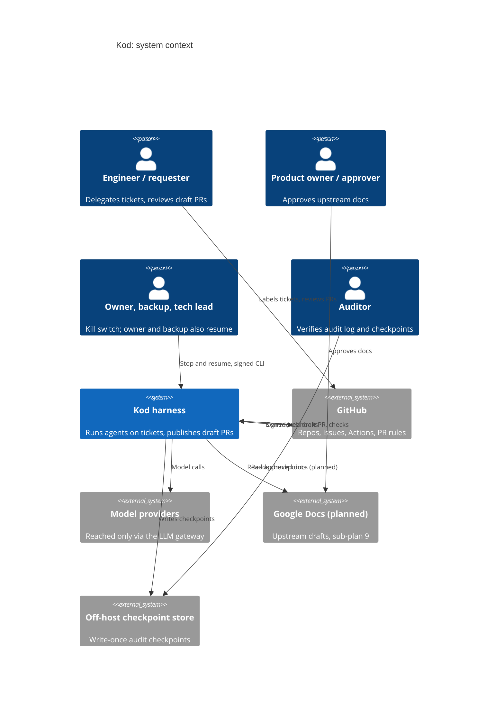
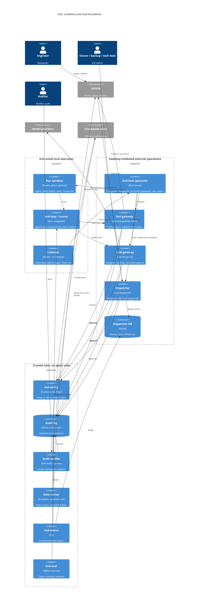
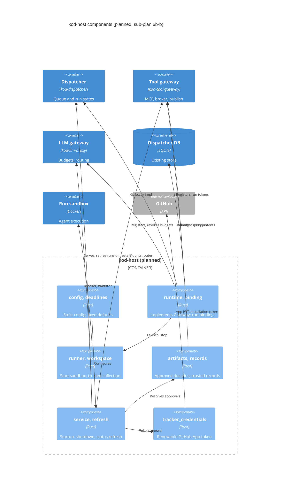

# Kod architecture (C4)

C4 views of Kod, as Mermaid. Levels 1 to 3 are here; Level 4 (code) is the Rust docs (`cargo doc --workspace --no-deps`). Elements marked **planned** are not built yet: `kod-host` is specified by [sub-plan 6b-b](superpowers/plans/2026-10-23-phase1-connected-host.md) and accepted by [6b-c](superpowers/plans/2026-10-23-phase1-connected-acceptance.md). Status of every sub-plan is in the [phase 1 overview](superpowers/plans/2026-10-14-phase1-overview.md). Rationale is in the [design doc](kod-harness-design.md).

## Level 1: System context

Kod receives signed GitHub webhooks, runs an agent in a sandbox and publishes only a draft PR to its own `agent/<ticket>` branch. Humans own every merge; nothing auto-merges.
Every external operation (GitHub, model, docs) goes through a gateway that checks policy, injects a short-lived credential and records the decision. The sandbox holds no long-lived credentials.
Audit checkpoints go to a store the harness host cannot alter, so an auditor can detect tampering or truncation.
Google Docs is planned (sub-plan 9, not started). Until then approved documents are local trusted exports.

## Level 2: Containers

Untrusted zone: only the sandbox, runner and collector run agent or repo code. They get opaque gateway tokens, no GitHub or model keys, no host filesystem or Docker socket, and an egress allowlist. Today the offline harness (`kod-eval`) starts them; `kod-host` taking over that role is planned.
Gateway zone: every external write passes policy, then an audit intent, then the call. Policy is a library inside each gateway and the dispatcher, not a service. The tool and LLM gateways exist today and run in one process; `kod-host` (planned, 6b-b) is the composition binary, and 6b-a adds the GitHub broker and forge to the tool gateway.
Trusted zone: gates run on a separate host and never share a sandbox or cache. The audit chain is checked off-host against write-once checkpoints. `kod-status` reads records and has no store of its own; `kod-eval` is offline and not part of the runtime path.
Not drawn: the owner's and backup's kill switch keeps working when policy or audit is down; there is no third database. Gate scanners run in their own images (`images/gates`).

## Level 3: Components of kod-host (planned)

`kod-host` is an assembly binary, not a new domain service: it reuses the existing routers and libraries and adds concrete adapters. Component names are the planned source files in the 6b-b plan; the plan, not this diagram, is authoritative if they diverge.
Enforced here: the dispatcher row is the sole durable stop flag; revocation starts before waiting for stop; no execution resumes after restart (active runs become NeedsHuman, `publishing` resolves only if the exact draft PR exists).
Also enforced: collection runs only after the process is quiescent, and refuses binary files, symlinks, renames and mode changes before any forge write. Admitted document revisions are pinned and a live issue edit cannot widen them.
The additive tables (`run_bindings`, `model_requests`, `tracker_write_intents`) live in the existing dispatcher database.
