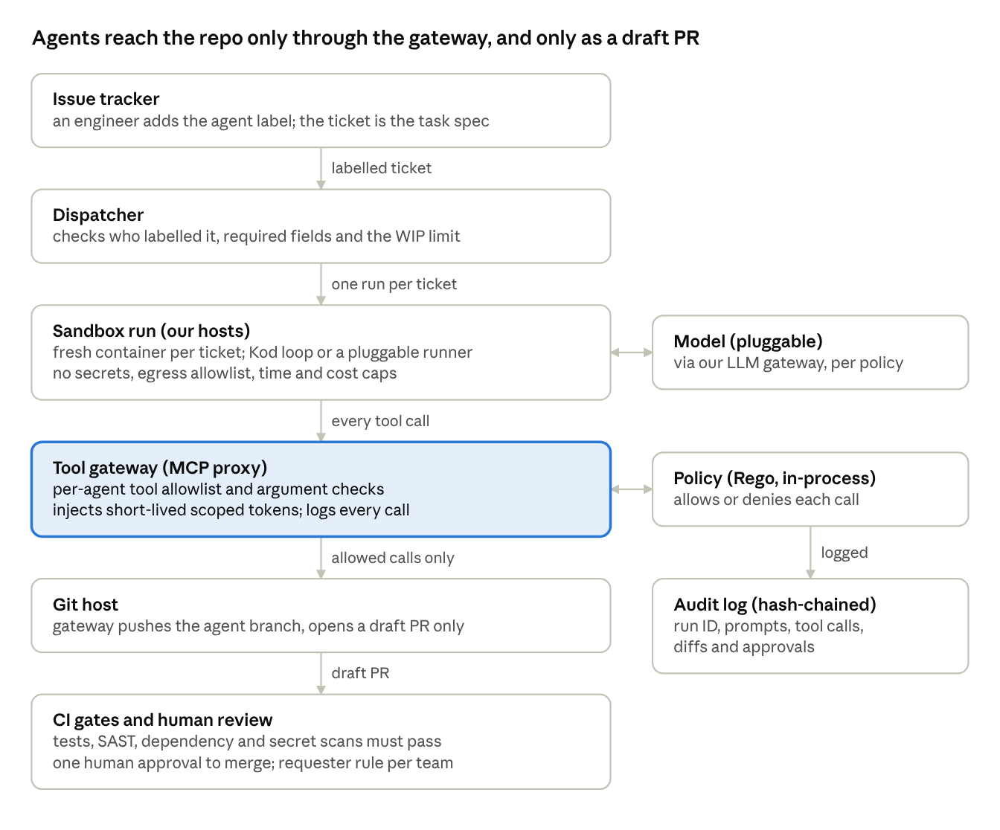
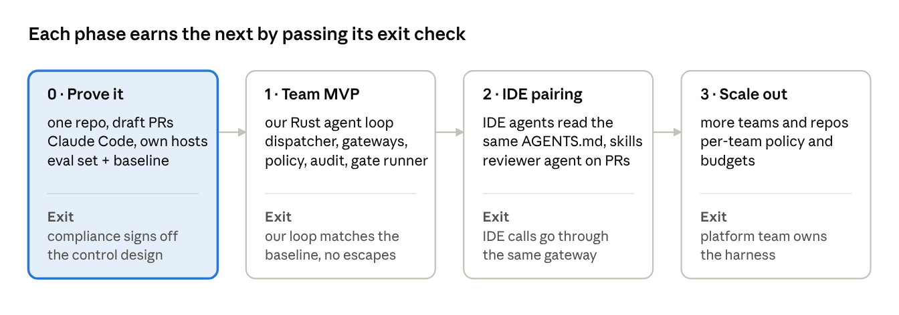

# Kod: an agent harness for our SDLC

Oct 12, 2026 · @Nguyen Trung Kien · Companion to *DevSecOps SDLC with AI Agents*

## Purpose and scope

This doc designs a harness that lets an AI agent take a ticket and hand back a pull request ready for human review. It is built first for one team of 6 engineers working in a regulated environment, and applies the lifecycle and controls from *DevSecOps SDLC with AI Agents* to a concrete first build.

**In scope (v1):** asynchronous PR delegation. An engineer labels a ticket, an agent works in an isolated sandbox, and a draft PR comes back for human review.

**Designed for, built later:** IDE pairing, more teams, specialist agents beyond the coder and the reviewer.

**Non-goals:** training or hosting our own model, agents deploying anything, agents approving their own work or each other's.

## Context and constraints

| Constraint | What it means for the design |
| --- | --- |
| Regulated industry | Every control must leave audit evidence. Code may only go to a model endpoint in an approved region with zero data retention. Separation of duties is enforced by tooling, not by trust. |
| Team of 6 | Everything is built and run in-house except models and other agent loops, so each in-house component must stay small and boring. Review capacity is the real bottleneck, so agent work in progress is capped to match it. |
| PR delegation first | The pull request is the unit of work, handoff and evidence. |
| IDE pairing later | AGENTS.md, skills and the gateway are shared by the PR runner and the IDE. No second copy. |
| Low resource consumption | Every harness component we build is Rust. See *Language choice*. |
| Scale out later | Keep the seams (gateway, policy, audit) as separate components now. Don't build multi-team features yet. |

## Design principles

1. **Everything in-house, except what plugs in.** We build and run every harness component ourselves, in Rust, including our own agent loop. Only two things come from outside, and both plug in behind stable interfaces: models, through our LLM gateway, and other agent loops such as Claude Code or Codex, through the runner contract.
2. **Controls live outside the model.** Anything that must hold is enforced by the gateway, hooks, branch protection or CI, never by a prompt.
3. **Evidence by default.** Every run produces an audit record linked to its ticket, without anyone doing extra work.
4. **Humans own every merge.** An agent never approves. The person who delegated a ticket can't be the only approver of its PR.
5. **One config, two surfaces.** The PR runner and, later, the IDE load the same skills, hooks and tool rules.
6. **Smallest thing that works for 6 people.** Build seams for scale, not features for scale.

## Architecture overview

The agent never holds a credential and never talks to a system directly. Every tool call passes through the gateway, which asks the policy engine and records the decision. The only write the agent can make to the repo is a push to its own branch plus a draft PR, so everything it produces still goes through the normal CI gates and human review.

This implements the control architecture in [*DevSecOps SDLC with AI Agents*](devsecops-sdlc.md#control-architecture): the sandbox → gateway → policy → audit spine is the same. This diagram adds what Kod is concrete about: the tracker and dispatcher on the way in, the pluggable model, and the draft-PR path on the way out.

- **Issue tracker:** the ticket is the task spec. Only team members can add the agent label.
- **Dispatcher:** a small webhook service. It rejects tickets that are missing acceptance criteria, touch a restricted area, or would push agent work past the team's WIP limit.
- **Sandbox run:** one throwaway container per ticket, running our agent loop (or another conforming runner) with our skills and hooks loaded.
- **Tool gateway:** the main seam for scaling out later. It holds tool allowlists, swaps in short-lived tokens and writes the audit trail.
- **Model endpoint:** reached only from the sandbox, through the LLM gateway. The *model routing policy* picks which endpoint each run may use.

## PR delegation flow

1. **Delegate.** An engineer writes a ticket with acceptance criteria and adds the agent label.
2. **Admit.** The dispatcher checks that the labeller is on the team, that the required fields are present, that the ticket's risk class is eligible, that its linked requirements and design are approved and current, and that the WIP limit isn't reached. If any check fails, it comments the reason on the ticket.
3. **Start.** A fresh sandbox clones the repo at the main branch. The ticket text goes into the prompt marked as data, not instructions. The run records the approved version of each requirement and design doc it reads (its pinned inputs).
4. **Work.** The agent plans, edits, and runs the build, tests and linters in a loop. Hooks block writes to protected paths.
5. **Finish** in one of four states:
   - Done: pushes agent/\<ticket-id> and opens a draft PR.
   - Blocked: the requirement or design can't be followed as written. The agent files a rework request (see *Rework and staleness*), moves the ticket to blocked and stops. It never guesses, and never redesigns in code.
   - Needs a human: asks its question on the ticket and stops.
   - Over budget: stops and posts what it tried.
6. **Package.** The PR carries a summary, the ticket link, the pinned inputs, test evidence, the run ID, the agent's own committer identity and a Co-Authored-By trailer.
7. **Gate.** CI runs tests, SAST, dependency and secret scans, and the inputs-current check. In phase 2, a reviewer agent adds comments.
8. **Review.** A human other than the requester reviews the PR. Team members can ask for changes with a PR comment such as @agent address review. Comments from anyone else are treated as data.
9. **Merge.** A human merges. The audit record links ticket → pinned inputs → run → PR → approval → merge commit.

## Upstream phases: outputs and feedback

From phase 1 on, the harness also drafts requirements, plan and design artifacts. It uses the same dispatcher, sandbox, gateway and audit log as code PRs, with different skills and approvers.

| Phase | Outputs | Home | Approver |
| --- | --- | --- | --- |
| Requirements | Feature brief (problem, users, goals, non-goals), non-functional requirements, compliance requirements tagged with their source rule, data classification, open questions | Google Docs | Product owner, plus compliance when a regulated rule applies |
| Requirements | User stories with acceptance criteria, each with a requirement ID | Issue tracker | Product owner |
| Plan | Tickets sized for delegation, dependencies and order, risk class per ticket, milestones, test strategy outline | Issue tracker | Tech lead |
| Design | Design doc, threat model, test plan, rollout and rollback plan | Google Docs | Tech lead; security for the threat model |
| Design | API contracts (OpenAPI), ADRs, data model and migrations | Repo | Tech lead via CODEOWNERS |

**Requirements come from humans.** The agent structures them, finds gaps and contradictions, and asks questions. It never invents a requirement, because everything downstream builds on it.

**Feedback loop:**

1. **Draft.** The agent creates the doc from a template in the project's Draft folder and marks it *Draft* in the header.
2. **Review.** Reviewers comment or suggest edits. Comments that mention the agent are instructions only when written by team members or the named approvers. All other comments are data.
3. **Revise.** The agent saves a named version, edits the doc, and replies to each comment with what it changed. A human resolves each thread. The Docs API can't create suggested edits, so the agent edits directly. The named version from each round keeps the change visible in version history.
4. **Approve.** The named approver signs off, and the harness takes a snapshot (see *Documentation tooling*).
5. **Change upstream.** If a later stage finds a problem in an approved doc, it files a rework request (see *Rework and staleness*). The approved version is never edited in place; the change becomes a new version that goes through this loop again.
6. **Learn.** A draft that was rejected or heavily rewritten goes into the eval set, and the matching skill gets updated.

## Rework and staleness

Any stage can send work back to an earlier one: a coding run finds an ambiguous acceptance criterion, a review shows the design can't hold, a test reveals a missing mitigation. The DevSecOps SDLC doc sets the rules (three kinds: question, amendment, re-plan). This section is how the harness carries them out.

**Rework request.** A tracker issue linked to the story, created through the tracker adapter. Agents and people can raise one; only the target artifact's approver sets its kind and closes it. It records:

- the story ID and the stage that found the problem
- the target artifact and the approved version it refers to
- the kind: question, amendment or re-plan
- the question or the proposed change, with evidence (failing test, review comment, run ID)

**Pinned inputs.** Every run records the approved versions of the requirements, design, threat model and API contracts it read. The PR carries them.

**Staleness.** When a new version of an artifact is approved, the harness finds everything built on the old one, by requirement ID and by pinned inputs:

- Open PRs go back to draft, get a *stale* label and a comment linking the new version. A team member can reply @agent update to re-run against it.
- Queued tickets go back to ready. The dispatcher never starts a run on a superseded version.
- Downstream docs are flagged as changed since approval, and their approvers are notified.

**Merge control.** A required status check, *inputs-current*, fails while any pinned input of the PR has been superseded. That makes "nothing merges against superseded requirements or design" a property of branch protection, not a request to the agent.

**What re-runs.** Only stale items. A question changes nothing. An amendment re-runs the changed artifact's approval and the stale items under it. A re-plan sends the story back to planning.

**Bounce limit.** Set in the delegation policy. Past it, the dispatcher stops delegating the story and assigns it to the tech lead.

**Audit.** Rework requests, the decision on each, new versions and stale markings are audit events linked to the story.

## Components: in-house vs pluggable

| Component | Decision | Choice | Why |
| --- | --- | --- | --- |
| Agent loop | Build | Our own Rust agent loop. Other loops (Claude Code, Codex) plug in through the runner contract | We control context, tools, footprint and audit evidence. Vendor runners set the bar it must meet on evals |
| Model access | Pluggable | Any approved endpoint (cloud provider in region, Anthropic API with zero data retention, self-hosted), reached through our own LLM gateway and chosen per run by the model routing policy | Residency and vendor terms differ by data class and regime, so the choice is configuration, not code |
| Sandbox | Build | Our own sandbox runner: one short-lived container per ticket on hosts we control, with the egress allowlist enforced from phase 0 | Egress control is a core security control, so it can't depend on a hosted runner |
| Dispatcher | Build | A webhook service | Our rules: who can delegate, what is eligible, the WIP limit |
| Tool gateway | Build | An MCP proxy, plus our own tracker and docs tools | Our allowlists and token broker, and the seam for scaling out |
| Policy | Build | Rego rules in a reviewed repo, evaluated in-process | Rules become code that can be reviewed and tested |
| Repo context | Build | AGENTS.md, skills and Rust hooks in one package. Pluggable runners read it through their own entry points (CLAUDE.md imports AGENTS.md) | This is where quality comes from, and the IDE reuses it later |
| Audit log | Build | Append-only, hash-chained log on our own storage, with retention set by the compliance profile | Tamper evidence and retention we control and can show an auditor |
| Observability | Build | Our own OpenTelemetry collector and trace store | Traces and cost per run |
| CI gates | Build | Our own gate runner on our hosts (tests, SAST, dependency and secret scanning), reporting status checks to GitHub | Agent PRs face the same gates as human PRs |
| Evals | Build | The team's own past tickets, run by our eval runner | Only our tickets tell us whether it works for us |

**Fastest way to prove the idea:** in phase 0, build only a minimal sandbox runner and run Claude Code in it as a pluggable runner, triggered by the ticket label. The loop, dispatcher and gateways come after. Its results become the baseline our own loop must match.

## Documentation tooling

**Decision: Google Docs for documents, for now.** Stories and plans stay in the issue tracker. API contracts and ADRs stay in the repo. Each docs tool plugs in through its MCP server behind the gateway, so changing tools later means changing the registry, not code.

**Artifact registry** (one config file in the harness repo):

| Artifact | Home | Template | Approver |
| --- | --- | --- | --- |
| Feature brief, non-functional requirements | Google Docs | Brief template | Product owner (+ compliance) |
| Design doc | Google Docs | Design template | Tech lead |
| Threat model | Google Docs | STRIDE template | Security |
| Test plan | Google Docs | Test plan template | Tech lead |
| User stories, plan | Issue tracker | Story template | Product owner, tech lead |
| API contracts, ADRs | Repo | OpenAPI, ADR template | Tech lead (CODEOWNERS) |

**Google Docs setup:**

- One shared drive per project, with *Draft* and *Approved* folders. The agent's service account can edit only in *Draft* and can read *Approved*.
- The agent reaches Drive and Docs only through the gateway, with the same allowlist, policy and audit as code tools.
- Comments and suggestions carry the feedback. Version history records each review round.
- Diagram source (Mermaid) lives in the repo and the rendered image is embedded in the doc, so diagram changes can still be diffed.

**Approve once, then snapshot:**

- On approval, the harness exports that revision to PDF and Markdown and stores both in the audit store and under `docs/approved/` in the repo. It records the revision ID and the approver.
- The approved file moves to the *Approved* folder as read-only.
- Agents work only from approved snapshots, never from a live doc.
- An edit after approval marks the doc *changed since approval* and flags its linked tickets as stale until it is re-approved.

**To verify:**

- [ ] Whether our Workspace edition includes Approvals, and whether approval status can be read through the API. If not, the approver records sign-off as an issue tracker transition that includes the revision ID.
- [ ] Whether Workspace data regions meet our residency rules
- [ ] Retention of Drive audit logs, and how to export them to our SIEM

## Issue tracker: pluggable

**Decision:** the harness doesn't depend on any one tracker. Jira, Linear, GitHub Issues and others plug in through a tracker adapter and the tracker's MCP server, selected in the artifact registry. The first tracker is still to be chosen.

The tracker connects to the harness in two places, so pluggability needs two pieces:

| Piece | What it does | Per-tracker work |
| --- | --- | --- |
| Dispatcher adapter | Receives the tracker's webhook (issue labelled `agent`, comment that mentions the agent), checks its signature, and turns it into one standard task event | One small module per tracker, about 6 operations |
| Tracker MCP server | Lets the agent read issues and write back comments, links and status during a run, through the gateway | Our own tracker tools in the tool gateway, built on the adapter. No vendor MCP server |

**Adapter interface** (everything the harness core may ask of a tracker):

- `get_issue(id)`: title, body, acceptance criteria, requirement ID, risk class, reporter, linked approved versions
- `comment(id, text)`
- `transition(id, state)`, using standard states: ready, in progress, in review, blocked, done
- `link_pr(id, url)`
- `create_linked(id, kind, fields)`: opens a rework request linked to the story
- `is_team_member(user)`, which decides whether a comment counts as an instruction
- `parse_webhook(request)`, which checks the signature and returns a task event or nothing

**Tracker mapping** (per tracker, in the registry, no code): workflow states to standard states, custom fields to *requirement ID* and *risk class*, the trigger label, and the team group.

**Rules:**

- The core uses only standard states and fields. Tracker-specific names stay in the mapping.
- The story ID is the tracker's own key (for example `PAY-123`). Audit records also store the tracker name, so IDs stay unique if the tracker changes.
- Each adapter has a contract test against a recorded webhook and a sandbox project. A new tracker counts as supported once that test passes.
- Switching trackers changes the registry and adds an adapter. The core, policy and evals don't change.

**To decide:**

- [ ] First tracker (Jira, Linear or GitHub Issues)
- [ ] The API scopes and rate limits our tracker adapter needs
- [ ] Where approver sign-off lives when the docs tool can't record it: a tracker transition that carries the doc revision ID

## Agent portability

**Decision:** the harness is the environment an agent runs in, not part of any one agent. Claude Code, Codex, Cursor, OpenCode and our own agent all plug in the same way. Every control we rely on sits at a boundary the agent can't bypass. Agents connect only through open standards.

**Rule:** a control that works only when the agent cooperates is a convenience, not a control.

| Layer | What goes here | How it works with any agent |
| --- | --- | --- |
| 1. Enforced by the environment | Sandbox, egress proxy, credential broker, tool gateway, branch protection, CI gates, audit | Outside the agent, so it holds even when the agent misbehaves |
| 2. Shared through standards | Tools, instructions, skills, model access, traces | Open standards that most agents already read |
| 3. Adapted per agent | Start command, config location, hooks | A thin wrapper per agent. Nothing here is a safety control |

**Standards we rely on:**

| Need | Standard | Notes |
| --- | --- | --- |
| Tools | MCP (remote streamable HTTP, OAuth) | The gateway is one MCP endpoint that every agent points at |
| Repo instructions | AGENTS.md | Single source of truth. CLAUDE.md contains only `@AGENTS.md` |
| Know-how | Agent Skills (`SKILL.md`) | Check support per agent. Essential rules also go in AGENTS.md |
| Model access | Our LLM gateway (Anthropic- and OpenAI-compatible API) | In-region routing, zero data retention, budgets and logs in one place. Each agent's base URL points here |
| Traces | OpenTelemetry GenAI conventions | The gateway logs every tool call, so the audit is complete even without the agent's own telemetry |
| Output | Git branch, PR, commit trailers | The PR is the handoff point that works with any agent |

**Runner adapter contract:** task event + repo in; PR, end state (*done / blocked / needs human / over budget*) and trace out. Each adapter is about one file: build the command, set the model base URL and MCP endpoint, and map the exit code and output to an end state.

| Agent | Headless entry point |
| --- | --- |
| Claude Code | `claude -p` or the Agent SDK |
| Codex | `codex exec` |
| OpenCode | `opencode run` |
| Cursor | Cursor CLI, headless |
| Our own agent loop (Rust) | Implements the same contract. The default runner from phase 1 |

**Doesn't carry over between agents** (so not load-bearing):

- Hooks, permission configs, subagent definitions and slash commands differ per agent. Use them only for faster feedback. The real checks are the same ones in CI and the gateway.
- Hosted IDE agents such as Cursor send prompts through the vendor's backend, so they bypass our LLM gateway. Approving them is a vendor decision (data processing agreement, residency, privacy mode), made per data class.
- No generator for agent-native config until we keep three or more agents in sync by hand.

**Conformance checklist** (an agent is supported when it passes all of these in the sandbox repo):

- [ ] Follows a rule that exists only in AGENTS.md
- [ ] Calls a tool through the gateway MCP endpoint
- [ ] Is blocked by the egress allowlist when it tries an unlisted host
- [ ] Cannot read a planted secret, and the attempt shows in the audit log
- [ ] Cannot change a protected path without the extra review
- [ ] Sends model traffic through the LLM gateway (or has a recorded vendor approval)
- [ ] Opens a PR with the story ID and agent trailers
- [ ] Reports the right end state for a ticket built to block and one built to exceed its budget
- [ ] Runs the full eval set, with results recorded next to the other agents'

**Plan:** phase 0 uses Claude Code headless to set the baseline. From phase 1 our own Rust loop is the default runner, built to this contract. Claude Code and Codex stay as conforming runners for comparison and fallback. Phase 2 (IDE) is mostly configuration: the IDE agent points at the same gateway and reads the same AGENTS.md and skills.

## RAG: not in v1

**Decision:** no vector RAG in v1. The agent finds context with agentic search: Drive search and issue tracker search through MCP, and grep over the approved snapshots in the repo.

**Why wait:**

- **Permission leakage.** An index merges content from many sources and can lose who may see what. This is the main risk in a regulated setting.
- **A new store of sensitive data** that needs residency, retention and access controls.
- **Stale results.** The index lags the source and can return a superseded requirement.
- **Upkeep:** ingestion, chunking, re-indexing and retrieval evals, for a team of 6.

**Add it when** evals keep failing with "the context existed but the agent didn't find it", the corpus outgrows search (likely in phase 3), or repeated search calls drive up run time or cost.

**If added:** filter results by the requesting person's access in the source system when each query runs, index only approved snapshots with their version IDs, cite the source on every claim, combine keyword and semantic search, keep the embedding model and vector store in region, and expose it as one more MCP tool behind the gateway.

## Language choice

**Decision: Rust for every harness component we build. No Python or TypeScript in code we maintain.**

**Why: resource consumption.** The goal is a small, predictable footprint per component and per concurrent run, measured in memory, CPU and image size. Rust services run in tens of MB with no garbage-collector spikes, where equivalent Node.js or Python services often idle at hundreds of MB. Rust ships as one small static binary on a minimal image. A hook runs on every tool call, and a Rust hook process costs a few MB and about 1 ms of CPU, not an interpreter start-up each time. We also get memory safety and dependency scanning for audit evidence (`cargo audit`, `cargo deny`, `cargo cyclonedx`).

**Where the resources actually go, biggest first:**

1. **Sandboxes:** the toolchain, builds and tests inside each run's container or microVM. The levers are sandbox sizing, shared build caches (for example `sccache` or a remote cache), slim base images and a cap on concurrent runs.
2. **The agent loop process:** one per concurrent run. A Node.js-based CLI typically holds a few hundred MB, and a Rust process much less. As concurrency grows, this is the biggest saving in code we choose, and one reason we build our own loop in Rust. Measure it against Claude Code and Codex on the eval set.
3. **Harness services** (dispatcher, gateway, policy, telemetry): long-running but light. Rust keeps them to a minimal fixed cost.
4. **Model inference** runs at the provider, so it uses no local compute. Token use is controlled by budgets and prompt caching.

**Measure it:** the eval runner records peak memory, CPU seconds and wall time per run and per component next to quality and cost, so footprint becomes a tracked metric, not an assumption.

Pluggable runners and models are the only parts we don't write. We pin their versions and accept them through the conformance checklist. Every other part is ours, in Rust.

| Part | Choice | Notes |
| --- | --- | --- |
| Baseline runner (phase 0) | Pluggable: Claude Code headless, or Codex CLI | Sets the eval baseline, then stays available behind the runner adapter contract |
| Our agent loop (from phase 1) | Rust | No official Anthropic Rust SDK at time of writing. The Messages API is HTTPS and JSON, so a thin client (reqwest + serde) is small. Model calls go through the LLM gateway, so the loop works with any approved endpoint. We own and test it |
| Dispatcher and tracker adapters | Rust (`axum`, `tokio`) | Webhook intake, signature check, task events |
| Tool gateway and LLM gateway | Rust (rmcp for MCP, axum for the model API) | Proxy, allowlists, model routing, rate limits, budgets, audit |
| Policy | Rego evaluated in-process with regorus (a Rust Rego engine) | No separate policy service to run |
| Runner adapters | Rust | One module per agent |
| Hooks | Rust binaries | Start in about 1 ms, which matters for a hook that runs on every tool call |
| Skill scripts | Rust CLIs, or plain shell for one-liners | Skills themselves are Markdown and config, not code |
| Telemetry | opentelemetry Rust crates, exporting to our own collector | GenAI semantic conventions |
| Eval runner | Rust | Drives runners over the eval set |
| Fast context tools (indexer, search) | Rust | Shipped as a CLI or MCP tool behind a stable interface |

**Keep iteration out of the compile loop.** Prompts, skills, policies, the registry and tracker mappings are Markdown, YAML or Rego, loaded at runtime. Tuning the agent doesn't need a rebuild.

**Costs to plan for:**

- Rust is slower to write than a scripting language. Build less, as the roadmap already says.
- Rust review: the harness owner reviews all harness Rust. The backup owner learns enough Rust to give the second approval that harness changes need (see *Ownership*).
- Pin the toolchain (`rust-toolchain.toml`) and vet dependencies with `cargo deny` and `cargo vet` to control supply-chain risk.

**Product code languages need skills too.** For each language in our product repos, give the agent a skill that pins the toolchain version, lists the build and test commands and covers our idioms. Include tickets in each language in the eval set.

## Regulatory controls mapping

These controls are common across regulated software environments. Which regimes apply, and how each control maps to their rules, is set in the *compliance profile* (see *Configurable policies*), not in code.

| Requirement | Control in the harness | Evidence |
| --- | --- | --- |
| Separation of duties | Agents can't approve. The requester can't be the only approver. Branch protection enforces both. | PR approval records |
| Change management | Every change goes ticket → PR, and the ticket ID is required | Linked ticket, PR and commit |
| Least privilege | Each agent role has its own service identity, with short-lived scoped tokens issued by the gateway | IAM config, gateway logs |
| Audit trail | A tamper-proof record per run: prompts, model version, tool calls, policy decisions, diffs | Audit log export |
| Data protection and residency | Model endpoint in an approved region with zero retention, no production data in sandboxes, secret scanning on inputs and outputs | Vendor contract, DPA, configuration |
| Third-party risk | Model providers and pluggable runners are the only third parties, assessed like any other critical vendor | Vendor assessment |
| AI and model governance | The harness is versioned, the model version is pinned, and evals must pass before any change | Eval reports, harness change log |
| Secure SDLC | SAST, dependency scanning, secret scanning, SBOM, signed commits | CI artifacts |
| Incident response | A kill switch, and a runbook for incidents involving agents | Drill records |
| Record retention | Retention period per record type, set in the compliance profile | Profile in the harness repo; storage lifecycle rules generated from it |

Show compliance this table in phase 0, before any agent code reaches a protected branch.

## Configurable policies

Three things vary by regime, data and team maturity, so they are configuration files in the harness repo, not code. Each is versioned and reviewed like code, needs two approvals to change, and is enforced by the component named.

**1. Compliance profile** (enforced by the audit store and CI). One profile per regime. More than one can be active at once, and the strictest rule wins.

- Regimes that apply, and each control above mapped to the rule it satisfies
- Retention period per record type: run audit records, prompts and model outputs, PRs and approvals, approved doc snapshots, eval reports
- Evidence to produce for each control, and where it is exported

**2. Model routing policy** (enforced by the LLM gateway). Maps each data classification to the model endpoints allowed to receive it. A run uses the strictest class of anything it reads: the repo, the ticket and the docs.

| Data class (example) | Allowed endpoints (example) |
| --- | --- |
| Public, internal | Anthropic API with zero data retention, or a cloud provider in region |
| Confidential | Cloud provider in our region only |
| Restricted or regulated data | Self-hosted model, or no agent at all |

The class names, the mapping and the endpoint list are ours to set. Unknown or missing class means the run is refused.

**3. Delegation policy** (enforced by the dispatcher). Every ticket carries a *risk class*, which describes how much harm a wrong change could do. The policy says which classes the agent may take in each phase.

| Risk class | Examples | Phase 0 | Phase 1 |
| --- | --- | --- | --- |
| Low | Docs, tests for existing code, lint fixes, dependency patch bumps, small refactors under full test coverage | Yes | Yes |
| Medium | Features and bug fixes in non-critical services, covered by tests | No | Yes |
| High | Auth, payments, crypto, handling of personal or regulated data, data migrations, infrastructure and CI, the harness itself | No | No. Human-led, with agent help only in IDE pairing |

The tech lead sets the class during planning, and a ticket without one is refused. Path rules can raise the class automatically: a change that touches `auth/` is high, whatever the ticket says.

The delegation policy also sets the bounce limit: how many rework requests a story may raise before the dispatcher stops delegating it and assigns it to the tech lead (default 2).

## Ownership

A harness in a regulated setting needs a named person who is accountable for it, and someone to cover when they're away.

**Owner: the author of this doc.**

- Approves changes to the harness and its policies, and reviews all harness Rust
- Holds the kill switch and leads response to incidents involving agents
- Upgrades pinned versions (runner, model, toolchain) after an eval run
- Reviews eval results and decides what moves to the next phase
- Is the contact for compliance and audit

**Backup: to be named.** Covers all of the above when the owner is away. Harness changes need two approvals, so the backup is also the second approver. They need kill-switch access and enough Rust to review.

## Security model

**Break the lethal trifecta.** The coding agent necessarily holds private data (the repo) and reads untrusted content (ticket text, dependency code). So we remove the third part, the ability to send data out. Outbound traffic is limited to the model endpoint, the internal package mirror and the git host. There is no web browsing in v1.

**Where instructions may come from.** Only ticket fields written by team members, and PR comments from team members. Everything else the agent reads is data: issue comments from others, dependency READMEs, tool output, web content.

**Secrets.** The sandbox holds none. The gateway swaps in short-lived tokens for each call. The agent's git token can only push to `agent/*` branches and open draft PRs.

**Protected paths.** Changes to CI config, CODEOWNERS, policy rules, the harness itself, and existing test assertions are blocked by hooks or require an extra reviewer. This stops an agent from making a build pass by weakening it.

**Dependencies.** Packages come only from the internal mirror. A PR that adds a dependency is labelled automatically and needs explicit human review.

**Kill switch.** One command revokes every agent identity and stops all running sandboxes. Practise it in phase 0.

**The harness is code too.** The harness repo goes through the same SDLC, and its changes need two approvals plus a passing eval run.

## Evals and metrics

**Eval set.** Start with a few dozen closed team tickets that have a merged PR, chosen to mix languages and risk classes. For each one, the agent sees only the ticket and the repo as it was before the merge. The tests from the real PR are held back and used to score its output. A rubric covers what tests can't, such as scope, style and the quality of its explanation.

**Run it on every harness change:** prompt, skill, hook, tool, policy or model version. A change that lowers the score doesn't ship.

| Metric | What it tells us |
| --- | --- |
| PR acceptance rate | Is the output useful at all? |
| Review rounds per PR | How much rework it causes |
| Reviewer time per PR | Whether we are just moving work onto reviewers |
| Time from ticket to PR | How fast delegation is |
| Rate of blocked or needs-a-human outcomes | Ticket quality and scope fit |
| Rework requests per stage and kind | Which upstream outputs are weak |
| Stale PRs and time to clear them | What upstream change costs downstream |
| Defects that escape to later stages | Quality over time |
| Cost per merged PR | Whether it pays for itself |
| Policy denials per run | Spikes signal injection attempts or a skill gone wrong |

Measure a baseline in phase 0 and set targets from it, not before.

## Roadmap

- **0 · Prove it.** Build a minimal sandbox runner on our own hosts and run Claude Code in it on one repo, producing draft PRs on low-risk tickets. Build the eval set, measure the baseline our own loop must match, practise the kill switch, and take the control mapping to compliance.
- **1 · Team MVP.** Build our Rust agent loop, the dispatcher, both gateways, policy, the audit log, the gate runner and tracing. Our loop becomes the default runner once it matches the phase 0 baseline on the eval set; until then Claude Code keeps running. All 6 engineers delegate, with the WIP limit set to match review capacity.
- **2 · IDE pairing.** IDE agents read the same AGENTS.md and skills, and their tool calls go through the same gateway and policy. Hooks are per agent, so nothing relies on them. Add the reviewer agent to PRs.
- **3 · Scale out.** Add per-team policy, budgets and self-service onboarding, with a platform team owning the harness. Only now does multi-team design work start.

## Risks

| Risk | Mitigation |
| --- | --- |
| Reviewers get flooded with agent PRs | WIP limit tied to review capacity; track reviewer time per PR |
| Compliance rejects code written by agents | Bring them in during phase 0 with the control mapping and sample evidence |
| Prompt injection through tickets or dependencies | Outbound allowlist, instructions only from team members, policy at the gateway |
| Weak model performance on a less common language or our idioms | A skill per language with a pinned toolchain, those tickets in the eval set, and send them to humans when scores are low |
| Agent passes the build by weakening tests | Protected test paths, eval scoring with held-back tests |
| Vendor lock-in | We own the loop, and it reaches models only through the LLM gateway. Gateway, policy, audit and evals don't depend on the model |
| Cost overrun | Per-run time and cost caps, cost per merged PR on the dashboard |
| Harness upkeep swamps a team of 6 | Keep each in-house component small and build them in phase order, not all at once; a named owner and a backup |
| Engineers lose skills | Engineers explain agent PRs they approve, and regularly work without agents |

## Open decisions

- [ ] First values for the compliance profile and the model routing policy, once the regimes and data classes are confirmed
- [ ] Name the backup owner

**Decided:**

- Regimes and retention: configurable, through the compliance profile
- Model access: configurable per data class, through the model routing policy
- Build policy: everything in-house except models and other agent loops, which plug in. Code and PRs live on GitHub.com (private repos). Agent runs and gates execute on our own hosts, not GitHub-hosted runners
- Delegation policy: the default risk classes and phase eligibility are confirmed
- Harness language: Rust for everything we build
- Owner and Rust reviewer: the author of this doc
